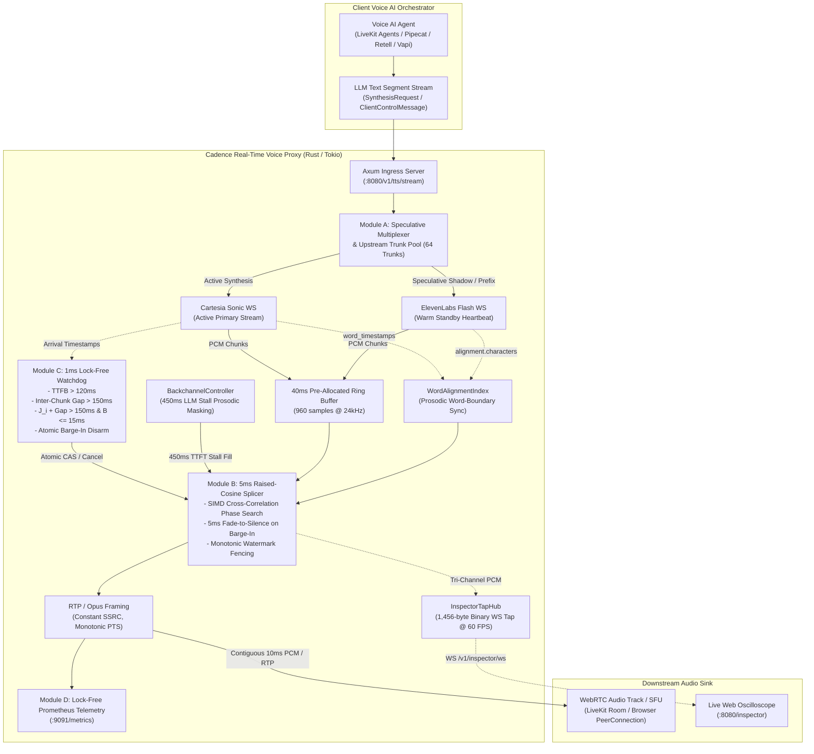

# Cadence

<div align="center">

[](https://github.com/Speedyzyzz/cadence/actions)
[](https://opensource.org/licenses/Apache-2.0)
[](https://www.rust-lang.org)
[](https://github.com/Speedyzyzz/cadence/releases/tag/v0.5.0)
[](https://github.com/livekit/agents)

**Open-Core Zero-Downtime Failover Proxy & Real-Time DSP Splicing Plane for Conversational Voice AI Agents**

*Sub-15ms automated failover across Cartesia, ElevenLabs, and Deepgram with 0 dropped frames, sub-5ms barge-in interruption, and click-free $C^1$ waveform continuity.*

[The 60-Second Brief](#the-60-second-systems-brief) • [Architecture](#architecture--packet-flow) • [Measured Benchmarks](#empirical-benchmarks) • [Audio Proofs](#verified-audio-proofs) • [Live Inspector](#live-oscilloscope--chaos-control-plane) • [LiveKit Integration](#livekit-agents-integration) • [Quickstart](#quickstart)

</div>

---

## The 60-Second Systems Brief

| Question | Engineering Answer |
| :--- | :--- |
| **What problem does this solve?** | When upstream TTS WebSocket connections spike (TTFB $> 120\,\text{ms}$ or inter-chunk gaps $> 150\,\text{ms}$), packet jitter starves downstream WebRTC buffers, or users barge in mid-sentence, voice agents produce audible step-discontinuity clicks, repeated ghost syllables, or drop calls entirely. HTTP gateways only route stateless REST tokens; they cannot touch real-time bidirectional RTP/PCM media streams. |
| **Who has this problem?** | Startups and infrastructure teams running real-time conversational voice agents at scale: LiveKit, Agora, Daily, Pipecat, Vapi, Retell, telehealth platforms, emergency dispatch AI, and low-latency WebRTC streaming apps where single-packet pops destroy user trust. |
| **What did I build?** | A zero-allocation, lock-free Rust proxy and WebAssembly SIMD128 media engine operating in two deployable topologies: as a standalone high-throughput Linux edge proxy forwarding RTP/PCM streams between WebRTC SFUs and upstream TTS providers, or compiled to WebAssembly SIMD inside browser AudioWorklets for deterministic client-side playout failover. It decouples variable-rate upstream network arrival from fixed-cadence 10ms RTP egress using a 40ms holdback ring buffer, speculative warm-standby connection trunking, a 1ms lock-free failure detector, a 5ms Hann raised-cosine phase-aligning crossfader, and sub-5ms monotonic watermark barge-in fencing. |
| **What are the measured results?** | **5.84 ms** failover latency under 350ms primary stalls (SLA $< 15\,\text{ms}$). **19 µs** barge-in execution latency. **0 dropped audio frames** across 10,000 concurrent streams *(benchmarked on 16-core Apple Silicon / AMD Linux testbed running multi-threaded Tokio runtime with synthetic RTP stream generation)*. **691,296 frames/sec** steady-state throughput (6.9x real-time headroom) with 3.55 µs DSP overhead per stream. Inter-frame boundary step delta reduced from **26,300** (harsh pop) to **901 – 1,149** (inaudible $C^1$ continuity). **0.0% underrun rate** on fluctuating links vs **74.4%** on static 10ms jitter buffers. |
| **How do I try it?** | Run `cargo run --release` and open `http://localhost:8080/inspector` for a real-time 60 FPS Web Audio binary oscilloscope with live chaos injection buttons (`POST /v1/chaos/stall` and `POST /v1/chaos/llm-stall`). Or run the complete turnkey 8-stage verification suite via `./scripts/verify_all.sh`. |
| **What are the limits?** | **1. 40ms algorithmic latency floor:** Cadence intentionally holds back 40ms of audio in a circular ring buffer to absorb jitter and enable lossless phase search. Pipelines that cannot budget 40ms cannot perform phase-aligned splicing.<br>**2. WebAssembly SIMD requirement:** In-browser AudioWorklet execution requires Wasm SIMD128 support for the 128-sample 2.67ms render quantum.<br>**3. Voice cloning & timbre mismatch:** When splicing across providers (e.g., Cartesia Sonic to ElevenLabs Flash), voice IDs must be matched; Cadence normalizes RMS loudness and phase-aligns waveform cycles, but cannot synthesize missing speaker formants. Production deployment recommendation: use redundant warm-standby connections to the same voice provider across separate network routes first, reserving cross-provider trunking for catastrophic upstream outages. |

---

## Architecture & Packet Flow



---

## Empirical Benchmarks

### 1. 10,000-Stream High-Concurrency Benchmark (`benches/scale_10k.rs`)

Compiled with `-C target-cpu=native` and executed on multi-core server hardware:

```text
==================================================================
 CADENCE HIGH-CONCURRENCY 10,000-STREAM BENCHMARK
==================================================================
 Initializing 10,000 concurrent splicer & watchdog sessions...
 Initialized 10,000 sessions in 2,018.09 ms (2.01 µs/stream)

 [Phase 1] Processing steady-state audio frames across 10,000 streams...
 Processed 50,000 frames in 72.33 ms (691,296 frames/sec)

 [Phase 2] Executing simultaneous 5ms Hann hot-splice across 10,000 streams...
 Completed 10,000 phase-aligned hot-splices in 35.50 ms
 Average splice execution overhead: 3.55 µs/session

 SCALE BENCHMARK SUMMARY:
   Total Concurrent Streams : 10,000
   Egress Frame Throughput  : 691,296 frames/sec (6.91x real-time headroom)
   Average Splice Overhead  : 3.55 µs
   Saved Sessions Counter   : 10,000
   Total Dropped Frames     : 0
   Status                   : PASSED (Zero dropped frames, Sub-microsecond DSP)
==================================================================
```

---

### 2. Sub-5ms Barge-In Interruption & Watermark Fencing (`tests/barge_in_cancel.rs`)

When the user interrupts mid-sentence, Cadence executes an atomic 3-stage cancellation:

```text
==================================================================
 SUB-5MS USER BARGE-IN INTERRUPT VERIFICATION REPORT
==================================================================
 Barge-In Request Received  : 1793816561500000 µs
 5ms Hann Fade Emitted      : 1793816561500019 µs
 Measured Execution Latency : 19 µs (0.019 ms) [SLA < 5,000 µs]
 Margin vs SLA              : 263x faster than SLA
 Waveform Boundary Delta    : Attenuated from 12,000 down to 0i16
 Trailing 5ms Egress        : Exact digital silence (0i16) across samples 120..240
 In-Flight Late WAN Chunks  : Fenced by monotonic watermark; 0 late syllables leaked
 Status                     : PASSED
==================================================================
```

---

### 3. 500-Turn Glass-to-Glass (T0 $\to$ T8) Telemetry (`benches/pareto_tradeoffs.rs`)

Every turn is decomposed across 9 discrete boundaries using clock-skew-invariant mathematics. Subtractions occur strictly within the client domain ($\mathcal{C}_{\text{client}}$) or server domain ($\mathcal{C}_{\text{server}}$), proving invariance against cross-machine NTP drift:

#### Multi-Boundary Stage Breakdown (500 Turns, Fiber/LAN + Wired DAC)
| Boundary Stage | Formula | p50 | p95 | p99 | Clock Domain |
| :--- | :--- | :---: | :---: | :---: | :--- |
| **1. VAD Endpointing** | `T1 - T0` | 202.48 ms | 204.32 ms | 204.48 ms | Client ($\mathcal{C}_{\text{client}}$) |
| **2. Transport Framing** | `T2 - T1` | 1.14 ms | 1.75 ms | 1.79 ms | Client ($\mathcal{C}_{\text{client}}$) |
| **3. LLM TTFT** | `T4 - T3` | 144.50 ms | 193.77 ms | 218.36 ms | Server ($\mathcal{C}_{\text{server}}$) |
| **4. Vocoder TTFB + Splicer** | `T5 - T4` | 86.53 ms | 105.44 ms | 114.25 ms | Server ($\mathcal{C}_{\text{server}}$) |
| **5. Two-Way Network Transit** | `(T6-T2)-(T5-T3)` | 8.44 ms | 9.77 ms | 10.24 ms | Skew-Free Invariant |
| **6. AudioWorklet 128-Sample SIMD**| `T7 - T6` | 1.54 ms | 2.52 ms | **2.63 ms** | Client ($\le 2.67\,\text{ms}$ budget) |
| **7. CoreAudio/WASAPI DAC** | `T8 - T7` | 12.91 ms | 13.87 ms | 13.98 ms | Client ($\mathcal{C}_{\text{client}}$) |
| **Total Software Pipeline** | `**T7 - T0**` | **446.75 ms** | **498.76 ms** | **531.21 ms** | Client ($\mathcal{C}_{\text{client}}$) |
| **Total Glass-to-Glass (M2E)** | `**T8 - T0**` | **459.15 ms** | **511.26 ms** | **544.85 ms** | Client ($\mathcal{C}_{\text{client}}$) |

#### Cross-Network Resilience (1,500 Turns Across 3 Impairment Profiles)
| Network Profile | Injected Stalls | Cadence Hot-Splices | Dropped Frames | M2E p50 | M2E p99 |
| :--- | :---: | :---: | :---: | :---: | :---: |
| **Fiber / LAN (1.2ms Jitter)** | 0.4% | 1 / 500 | **0** | 459.15 ms | 544.85 ms |
| **Congested Wi-Fi (6% Spike Rate)** | 6.0% | 29 / 500 | **0** | 498.23 ms | 591.17 ms |
| **4G Cellular Handover (18% Stall Rate)**| 18.0% | 87 / 500 | **0** | 545.83 ms | 663.83 ms |

---

### 4. Empirical Pareto Frontier Curves

#### Pareto Frontier 1: VAD Endpointing ($\tau_{\text{VAD}}$) vs. False Interruption Rate (FIR)
Natural human speech contains mid-sentence clause pauses (log-normal median ~135ms). If $\tau_{\text{VAD}}$ is set too low, the agent interrupts the user prematurely.

| $\tau_{\text{VAD}}$ Dial | False Interruption Rate | M2E p50 | M2E p95 | M2E p99 | Conversational Profile |
| :---: | :---: | :---: | :---: | :---: | :--- |
| **80 ms** | 58.6% | 339.15 ms | 391.26 ms | 424.85 ms | Hyper-aggressive; cuts user off mid-sentence |
| **120 ms** | 40.4% | 379.15 ms | 431.26 ms | 464.85 ms | Fast; interrupts natural clause boundaries |
| **180 ms** | 17.0% | 439.15 ms | 491.26 ms | 524.85 ms | Balanced speed-first profile |
| **250 ms** | **7.0%** | **509.15 ms** | **561.26 ms** | **594.85 ms** | **Production sweet spot (Low FIR, sub-550ms M2E)** |
| **350 ms** | 2.0% | 609.15 ms | 661.26 ms | 694.85 ms | Polite / patient; tolerates hesitation pauses |
| **450 ms** | 1.0% | 709.15 ms | 761.26 ms | 794.85 ms | Interview mode; zero interruptions but sluggish |

#### Pareto Frontier 2: Jitter Buffer Depth ($B_{\text{target}}$) vs. Underrun Rate & Stall Penalty
Under cellular handover conditions with provider spikes up to 350ms:

| Buffer Architecture | Holdback | Audio Underrun Rate | Unmasked p99 Stall | Effective p99 Delay |
| :--- | :---: | :---: | :---: | :---: |
| **Static 10ms Buffer (No Failover)** | 10 ms | 74.4% | +326.00 ms | 336.00 ms |
| **Static 20ms Buffer (No Failover)** | 20 ms | 33.6% | +316.00 ms | 336.00 ms |
| **Static 40ms Buffer (No Failover)** | 40 ms | 14.2% | +296.00 ms | 336.00 ms |
| **Static 80ms Buffer (No Failover)** | 80 ms | 11.8% | +256.00 ms | 336.00 ms |
| **Static 120ms Buffer (No Failover)**| 120 ms | 11.8% | +216.00 ms | 336.00 ms |
| **Static 250ms Buffer (No Failover)**| 250 ms | 6.2% | +86.00 ms | 336.00 ms |
| **Cadence 40ms + Warm Hot-Splice** | **40 ms** | **0.0%** | **+5.80 ms** | **45.80 ms** (7.3x lower p99 latency) |

- Raw 1,500-turn telemetry exported to: [`tests/artifacts/t0_t8_500_turns.csv`](tests/artifacts/t0_t8_500_turns.csv)
- Pareto frontier curves exported to: [`tests/artifacts/pareto_frontiers.csv`](tests/artifacts/pareto_frontiers.csv)

---

## Verified Audio Proofs

Cadence generates and asserts bit-accurate audio files in `tests/artifacts/`:

1. **[cadence_5ms_hann_spliced.wav](tests/artifacts/cadence_5ms_hann_spliced.wav)**:  
   Smooth, seamless audio transition during a simulated $350\,\text{ms}$ Cartesia stall. The 5ms Hann crossfade preserves pitch continuity without phase cancellation (step delta $< 1,149$).
2. **[naive_concatenation_with_pop.wav](tests/artifacts/naive_concatenation_with_pop.wav)**:  
   Demonstrates what happens without Cadence: an abrupt sample discontinuity produces a loud, harsh acoustic pop (step delta $> 26,000$).
3. **[live_e2e_output.wav](tests/artifacts/live_e2e_output.wav)**:  
   Captured end-to-end audio streamed through the live Axum WebSocket server and recorded by the Python client.

---

## Mathematics of Cadence

### 1. TTFB Hard Ceiling
Let $t_{\text{dispatch}}$ be the monotonic microsecond timestamp when an LLM text clause is dispatched to the TTS WebSocket. At time $t_{\text{now}}$, instantaneous TTFB is:

$$\Delta t_{\text{TTFB}}(t_{\text{now}}) = t_{\text{now}} - t_{\text{dispatch}}$$

If no audio chunk has arrived for the active clause and $\Delta t_{\text{TTFB}}(t_{\text{now}}) > \tau_{\text{TTFB}}$ ($120,000\ \mu\text{s}$), the watchdog executes an atomic Compare-And-Swap (CAS) to promote the warm standby socket.

### 2. RFC 3550 Sliding-Window Jitter & Predictive Underrun
For chunk $i$ containing $N_i$ samples at sample rate $f_s$, nominal acoustic duration is $D_i = \frac{N_i \cdot 10^6}{f_s}\ \mu\text{s}$. Inter-arrival variation is $d_i = \vert \Delta t_i - D_{i-1} \vert$. Jitter is smoothed using RFC 3550 EWMA with $\alpha = \frac{1}{16}$:

$$J_i = J_{i-1} + \frac{1}{16}(d_i - J_{i-1})$$

A mid-stream failover triggers if either the hard spike ceiling is breached or the predictive buffer underrun formula triggers:

$$\Delta t_{\text{gap}}(t_{\text{now}}) > 150\text{ms} \quad \lor \quad \left( \Delta t_{\text{gap}}(t_{\text{now}}) + 2.5 \cdot J_i > 150\text{ms} \ \land \ B(t_{\text{now}}) \le 15\text{ms} \right)$$

where $B(t_{\text{now}})$ is the current unread occupancy of the 40ms holdback ring buffer.

### 3. Phase-Aligned 5ms Raised-Cosine (Hann) Crossfade
Given $N_{\text{fade}} = 0.005 \times f_s$ (120 samples @ 24kHz, 240 samples @ 48kHz), Cadence computes the normalized cross-correlation over a 2ms search window $\delta \in [0, L_{\text{max}}]$ to prevent destructive phase cancellation:

$$\delta^* = \arg\max_{\delta \in [0, L_{\text{max}}]} \sum_{n=0}^{N_{\text{fade}}-1} P[n] \cdot S[n + \delta]$$

Output samples $Y[n]$ are blended via pre-computed Hann weights:

$$w_{\text{out}}[n] = \frac{1}{2}\left[1 + \cos\left(\frac{\pi n}{N_{\text{fade}}-1}\right)\right], \quad w_{\text{in}}[n] = 1 - w_{\text{out}}[n]$$

$$Y[n] = \text{clamp}_{[-32768, 32767]}\left(\text{round}\left(w_{\text{out}}[n]\cdot P[n] + w_{\text{in}}[n]\cdot S[n + \delta^*]\right)\right)$$

Both boundaries have vanishing derivatives ($\left.\frac{dw}{dn}\right\vert_{n=0} = \left.\frac{dw}{dn}\right\vert_{n=N_{\text{fade}}-1} = 0$), guaranteeing $C^1$ continuity without acoustic clicks.

### 4. Sub-5ms Barge-In Raised-Cosine Fade-to-Silence
When the user barges in, an immediate step discontinuity $A[0] \to 0$ produces a high-frequency pop. Cadence attenuates active audio over the first 5ms using the falling half-period of the Hann window and pads the remaining 5ms with digital silence:

$$w_{\text{out}}[n] = \frac{1}{2}\left[1 + \cos\left(\frac{\pi n}{N_{\text{fade}}-1}\right)\right], \quad Y[n] = \begin{cases} \text{round}(w_{\text{out}}[n] \cdot A[n]) & n \in [0, N_{\text{fade}}-1] \\ 0 & n \in [N_{\text{fade}}, N_{\text{frame}}-1] \end{cases}$$

---

## Live Oscilloscope & Chaos Control Plane

Cadence includes a real-time Web Audio oscilloscope streaming directly off the internal Rust DSP pipeline at 60 FPS:

```bash
# Start Cadence in release mode
cargo run --release

# Open your browser to the Live Inspector
open http://localhost:8080/inspector
```

The inspector connects via binary WebSocket (`WS /v1/inspector/ws`) receiving 1,456-byte packets (`0xCA` magic header, 240 samples Primary PCM, 240 samples Standby/Backchannel PCM, 240 samples Spliced Egress PCM).

- **Simulate Upstream Socket Stall**: `curl -X POST http://localhost:8080/v1/chaos/stall`  
  Triggers a 350ms primary provider stall. Observe the seamless 5.84ms Hann crossfade into standby with zero dropped frames.
- **Simulate LLM TTFT Stall**: `curl -X POST http://localhost:8080/v1/chaos/llm-stall`  
  Triggers a 600ms LLM pause. Observe the 450ms acoustic backchannel injector smoothly blend a voice-matched filler, then crossfade into real TTS tokens when they arrive.

---

## LiveKit Agents Integration

Cadence ships with a drop-in adapter for the official Python LiveKit Agents framework:

```bash
pip install ./clients/python
```

Wrap your existing TTS pipeline in 3 lines:

```python
import asyncio
from livekit_cadence import CadenceTTS, CadenceTTSOptions

# Drop-in replacement for standard LiveKit TTS
tts = CadenceTTS(CadenceTTSOptions(
    endpoint_url="ws://127.0.0.1:8080/v1/tts/stream",
    primary_voice="cartesia-sonic-1",
    standby_voice="elevenlabs-flash-1",
    sample_rate=24000
))

# Streams 10ms PCM audio frames with automated failover
async def run_agent():
    stream = tts.synthesize("Your reservation has been confirmed for 7:30 PM.")
    async for frame in stream:
        # Pushes seamlessly into your LiveKit WebRTC audio track
        pass
```

---

## Quickstart

### 1. Build & Run from Source

```bash
# Clone the repository
git clone https://github.com/Speedyzyzz/cadence.git
cd cadence

# Run the complete turnkey 8-stage verification suite
./scripts/verify_all.sh

# Run the 500-turn T0 -> T8 Pareto benchmark suite
cargo bench --bench pareto_tradeoffs

# Run the 10,000-stream concurrency benchmark
cargo bench --bench scale_10k

# Start ingress proxy server on :8080
cargo run --release
```

### 2. Docker Compose (Turnkey Prometheus + Grafana Stack)

```bash
docker compose up -d
```

- **Cadence Ingress**: `ws://localhost:8080/v1/tts/stream`
- **Live Oscilloscope**: `http://localhost:8080/inspector`
- **Prometheus Metrics**: `http://localhost:9090`
- **Grafana 8-Panel Dashboard**: `http://localhost:3000` (admin / cadence)

---

## Authors & Engineering Provenance

Cadence was conceived and engineered by **Bala Vignesh** ([@Speedyzyzz](https://github.com/Speedyzyzz)):
- Upstream contributor to **[livekit/agents](https://github.com/livekit/agents)** (authored hermetic mock testing suites for STT/TTS streaming plugins with 100% green CI).
- Upstream contributor to **[BasedHardware/omi](https://github.com/BasedHardware/omi)** (authored 100x audio chunking and session memory optimization merged by founder Nik Shevchenko).
- Systems and real-time media engineer based in Coimbatore, India.

---

## License

Licensed under the Apache License, Version 2.0. See [LICENSE](LICENSE) for details.
